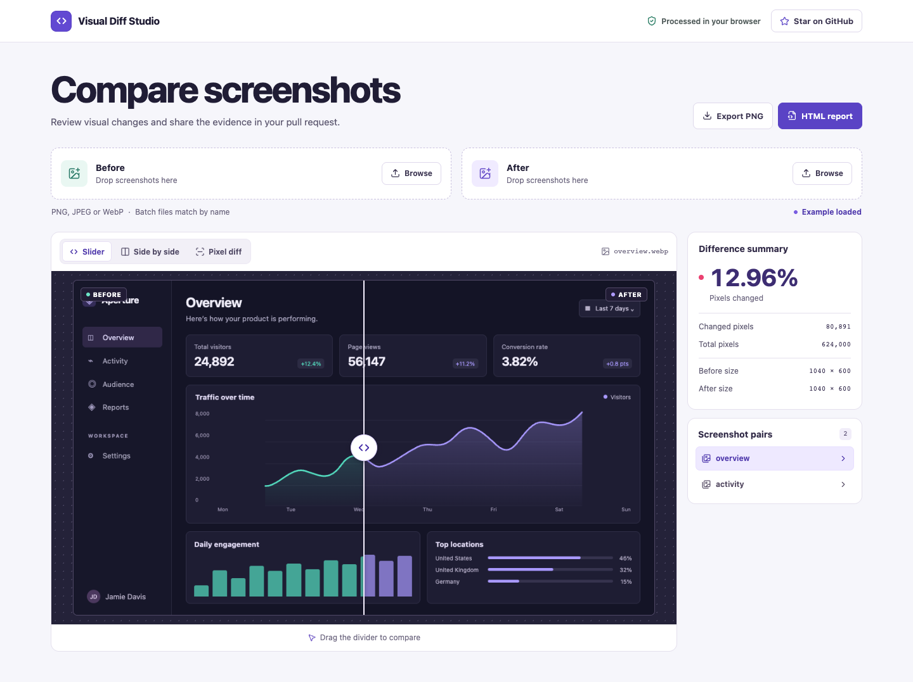

# Visual Diff Studio

[](https://github.com/ruslanty/visual-diff-studio/actions/workflows/ci.yml)
[](LICENSE)
[](https://github.com/ruslanty/visual-diff-studio/stargazers)
[](https://ruslanty.github.io/visual-diff-studio/)

**Compare screenshots. Show what changed in your pull request.**

Drag in before and after images, inspect changed pixels, and export a PNG or an offline HTML report. Everything runs in your browser.

[Live demo](https://ruslanty.github.io/visual-diff-studio/) · [Quick start](#quick-start) · [Star on GitHub](https://github.com/ruslanty/visual-diff-studio)



[View the GIF demo](docs/demo.gif)

## Features

- **Three comparison views.** Scrub with the before/after slider, place images side by side, or highlight changed pixels in pink. See the percentage changed and a warning when image sizes differ.
- **Single pairs or batches.** Drag in PNG, JPEG, or WebP files. A single pair can have different names. Batches match by filename, ignoring case and extension.
- **Reports for pull requests.** Export a labeled PNG for the selected pair or one self-contained HTML report for the whole batch.
- **An example at launch.** Try both built-in screenshot pairs before adding your own files.

## Quick start

Requires Node.js 24 LTS.

```sh
git clone https://github.com/ruslanty/visual-diff-studio.git
cd visual-diff-studio
npm ci
npm run dev
```

Open the local URL printed by Vite and drag the slider on the built-in example.

## Use it in a pull request

1. Drop your baseline screenshots in **Before** and the updated screenshots in **After**. In batches, `home.png` matches `Home.webp`, and unmatched or ambiguous files appear below the upload controls. Each drop replaces that side's selection.
2. Select a pair and switch to **Pixel diff** to inspect the changes.
3. Choose **Export PNG** and attach the image to your PR. For a batch, choose **HTML report** and share the file as an artifact that reviewers can open offline.

The app aligns images at the top left and compares their decoded pixels, including alpha. Positions covered by only one image count as changed. Each input image and the combined comparison canvas are limited to 4,096 px per side and 16 megapixels (16,000,000 pixels). Exports may scale large images while retaining full-resolution counts.

## Development

Run `npm test` for unit tests, `npm run build` for type checking and the production build, or `npm run preview` to serve the build. GitHub Actions runs unit tests, builds, and browser tests on pull requests and pushes to `main`. The Pages workflow runs the same checks before deployment. See the [release checklist](docs/release.md) for GitHub Pages setup.

With Google Chrome installed, run `npm run build` and `npm run test:browser` to test upload regressions in the production build.

[MIT License](LICENSE)
